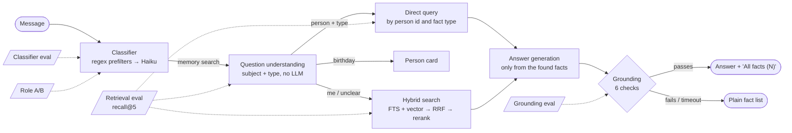

# Evals

How the memory pipeline is measured, so that a prompt, a model or a retrieval change is judged by numbers instead of by
feel. Only **synthetic** cases live in this repository; real-data cases and results stay in `data/evals/`
(gitignored) and appear here as aggregates only. Design rationale: [ADR-0030](CASES/0030-evals.md). A worked example
of what these evals are for: [why memory RAG "did not work"](CASES/0031-why-memory-rag-failed.md).

**Rule:** any change that touches evals (dataset, metrics, thresholds) ships with a case in `docs/CASES/` (same format as the existing ones): what is checked, metrics before/after, 2–3 input → expected-output examples, fictional names only (Тучка, Пончик, Рыжик). Example: [Case 0032](CASES/0032-cats-subject.md).

```bash
python -m evals offline        # all offline evals, ~2 s, no LLM and no network (needs Postgres, like the tests)
```

## The pipeline and where each eval looks



## 1. Classifier eval — `evals/classifier_eval.py`

**What it checks.** Whether changing the model or the prompt changes what the bot understands. There is no ground
truth for free-form messages, so it measures *agreement between two models* and lets a human read the differences.
The offline version checks that the deterministic branches (regex prefilters) return the expected intent **without
calling the model at all**.

**Metrics.** Intent-type agreement on messages that reached the LLM; strict agreement (whole JSON, noisy: priorities and
categories are judgement calls); latency p50/p95; tokens (input / cache write / cache read / output); cost per 1,000
messages.

```bash
python -m evals.classifier_eval offline                                  # CI: synthetic, 0 LLM calls
python -m evals.classifier_eval run --cases evals/synthetic/classifier_ab_cases.jsonl \
       --a claude-haiku-4-5-20251001 --b claude-haiku-5-5 --out -        # live A/B, summary on stderr
```

**Example case** (`evals/synthetic/classifier_cases.jsonl`):

```json
{"text": "remind me about the dentist", "expected_types": ["memory_search"]}
```

**Example output** (A/B, synthetic set):

```json
{ "messages": 44, "reached_llm": 33, "agree_types_pct": 93.9, "agree_strict_pct": 36.4,
  "latency_ms_a": {"p50": 999}, "latency_ms_b": {"p50": 978},
  "usd_a_per_1k_msgs": 2.29, "usd_b_per_1k_msgs": 0.27 }
```

Real messages: set `EVAL_CAPTURE=1` on the server to append incoming message texts (no user id) to
`data/evals/captured_messages.jsonl`, then `python -m evals.classifier_eval collect --captured … --limit 100`.

## 1b. Cat health input eval — `evals/cat_health_eval.py`

**What it checks.** Whether a message about a cat's weight, vet visit or medicine course ends up in the health tables (and nothing else does): gate
(name + health word, no LLM), strict validation of the model's optional `"здоровье"` object, cat resolution. Outcome accuracy, `false_health`
(a record that must not exist) and `missed`. `offline` uses hand-written model answers (in `python -m evals offline`); `live` calls the real Haiku with
the real prompt. See [Case 0036](CASES/0036-cat-health-input.md).

```bash
python -m evals.cat_health_eval offline
ANTHROPIC_API_KEY=… python -m evals.cat_health_eval live      # fictional text only, cents
```


## 1c. Cat fact block eval — `evals/cat_block_eval.py`

Block of a cat fact (profile | care | health | relations | owner | unsorted) and who may see it. Key metric: `false_open` (a closed fact became visible to the sitter) must be 0.
`offline` is part of `python -m evals offline`; `live` sends fictional text to the real Haiku. See [Case 0037](CASES/0037-cat-fact-blocks.md).

```bash
python -m evals.cat_block_eval offline
ANTHROPIC_API_KEY=… python -m evals.cat_block_eval live      # fictional text only, cents
```

## 2. Retrieval eval — `evals/memory_eval.py`

**What it checks.** Whether the right facts are among the top five for a question, and whether the question was routed
correctly (direct lookup / birthday / "me" / hybrid).

**Metrics.** `recall@5 = |expected ∩ top5| / min(5, |expected|)` (capped: five slots is all the bot shows);
`precision@5`; route accuracy; **ambiguity handling** (for questions flagged ambiguous: subject `ambiguous` and at least
the expected number of labelled blocks, i.e. everyone is shown and nobody is chosen). A question with no expected facts
scores 1.0 only if nothing is returned. Results are also reported per case group (`people`, `cats`) so a new group cannot
hide a regression in an old one.

```bash
python -m evals.memory_eval offline        # synthetic world, vector off (FTS + question understanding)
python -m evals.memory_eval compare        # legacy ILIKE → hybrid → current, same questions
python -m evals.memory_eval suggest "what does <person> not like"   # candidates (id/type/category, no texts)
python -m evals.memory_eval run --cases data/evals/memory_cases.jsonl    # private cases, on the server
```

**Example case** (symbolic names are resolved to ids when the synthetic world is built):

```python
("what does alex not like", ["m1_dis1", "m1_dis2", "m1_wrongtype", "m2_dis"], "direct")
# cats: query, expected facts, route, extra (a cat and a person share a name -> two blocks expected)
("что не ест тучка", ["t_dis", "tp_dis"], "direct", {"ambiguous": 2})
```

**Example output:**

```json
{ "questions": 19, "recall_at_5_pct": 100.0, "precision_at_5_pct": 91.2, "route_acc_pct": 100.0,
  "ambiguity_acc_pct": 100.0,
  "by_group": {"people": {"questions": 9, "recall_at_5_pct": 100.0, "precision_at_5_pct": 94.4, "route_acc_pct": 100.0},
               "cats": {"questions": 10, "recall_at_5_pct": 100.0, "precision_at_5_pct": 88.3, "route_acc_pct": 100.0}},
  "routes": {"direct": 11, "birthday": 1, "hybrid_self": 1, "hybrid": 3, "hybrid_cat": 1, "unknown_person": 2}, "misses": [] }
```

The synthetic world deliberately contains traps: two people called Alex (both must appear), a fact whose stored type
is wrong ("does not like" typed as "likes"), a pending fact that must never show up, the owner's own facts. The cats
group adds a person named like a cat, a removed cat card whose fact must not surface, a cat fact with no card, and
nickname / declension lookups (see [Case 0032](CASES/0032-cats-subject.md)).

## 3. Grounding eval — `evals/grounding_eval.py`

**What it checks.** The validator that decides whether a generated paraphrase may be shown. Honest answers must pass;
invented numbers, names, concepts, foreign fact ids, uncited phrases and empty answers must not.

**Metrics.** Accept rate on honest answers; **reject recall** on adversarial ones (the dangerous direction); whether the
rejection names the right check (`2` foreign id, `3` no ids, `4a` number, `4b` name, `4c` concept, `1/5/6` format, size,
empty).

```bash
python -m evals.grounding_eval offline
python -m evals.grounding_eval live --cases data/evals/memory_cases.jsonl     # real Haiku on the server
```

**Example case** (`evals/synthetic/grounding_cases.json`): the facts say the meeting is at 18:30; an answer saying 19:30 is
expected to be rejected by check `4a`.

**Example output:**

```json
{ "cases": 13, "accept_rate_pct": 100.0, "reject_recall_pct": 100.0, "check_match_pct": 100.0, "wrong": [] }
```

## 4. Short-role A/B — `evals/role_eval.py`

Replays synthetic inputs through the functions the bot actually calls (Arcana intent router, delete-intent parsing,
memory fact parsing, task category, spell correction) with two models and reports agreement and latency. It exists so a
cheaper model can be adopted role by role; see the table below for what it found.

```bash
python -m evals.role_eval run --a claude-haiku-4-5-20251001 --b claude-haiku-5-5
```

## Results

Aggregates only. Synthetic sets are small by design, so read them as "the machinery works and regressions are caught",
not as quality claims; real-data numbers are tracked privately.

| Date | Eval | Model(s) | Result |
|---|---|---|---|
| 2026-11-01 | Classifier branches (offline, CI) | regex, no LLM | **100%** (15/15), 0 LLM calls |
| 2026-11-01 | Retrieval (offline, CI) | FTS + question understanding | recall@5 **100%**, precision@5 100%, route accuracy 100% (9 questions) |
| 2026-11-01 | Retrieval: legacy → hybrid → current | `ILIKE` → FTS+RRF → +understanding | recall@5 **72.2% → 86.1% → 100%**; precision@5 59.3% → 61.5% → 100% |
| 2026-11-02 | Retrieval, cats (offline, CI; before = code without search by cat) | FTS + question understanding | recall@5 **78.9% → 100%** (19 questions), route accuracy 68.4% → 100%, ambiguity handling 0% → 100% ([Case 0032](CASES/0032-cats-subject.md)). Note: the synthetic world gained cat rows, so `compare` precision now reads 51.9% / 54.1% / 94.4% (recall unchanged: 72.2% / 86.1% / 100%) |
| 2026-11-01 | Grounding (offline, CI) | validator | accept 100%, reject recall 100%, check match 100% (13 cases) |
| 2026-11-01 | Classifier A/B | Haiku 4.5 vs 5.5 | type agreement **93.9–100%** over three runs (33 LLM-path messages; the misses are two budget phrasings: `stats` vs `unknown`); latency p50 ≈ 0.93–1.0 s vs 0.92–0.98 s |
| 2026-11-01 | Classifier cost | Haiku 4.5 / 5.5 | **$2.2 → $0.27** per 1,000 LLM-path messages (both with prompt cache) |
| 2026-11-01 | Prompt cache (classifier) | Haiku 4.5 | 14,252-token system prompt: second call read all of it from cache, latency 948 → 698 ms |
| 2026-11-01 | Short-role A/B | Haiku 4.5 vs 5.5 | intent router 87.5% (n=8), delete-intent 50% (n=4), memory fact parsing 20% (n=5; mostly key/category formatting), task category 100% (n=5), spell 100% (n=5) |
| 2026-11-01 | Generated answers (live) | Haiku 5.5, thinking off | 4/4 accepted on private questions, p50 ≈ 1.6 s, ≈ 1.6K input / 0.3K output tokens each; fallback rate over real traffic: collecting (`scripts/memory_answer_stats.py`) |
| 2026-11-01 | Model cost estimate (30 days) | assumption-based, ≈ 60 messages/day | classifier ≈ **$21 → ≈ $4** from the prompt cache alone on Haiku 4.5, ≈ **$0.5** on 5.5 |

### What the evals found (and the tests could not)

- The classifier prompt carried **only the date**, so "in an hour" was guessed by Haiku 4.5 (wrong clock time) and came
  back as a literal template placeholder from Haiku 5.5. Fixed for both models by a non-cached tail with the current time.
- A model replying to a bare "thanks" with chat text was recorded as a parse error. A reply with no JSON at all is now
  treated as "no command".
- The cheaper model is **not** a drop-in for every role: it changed the Arcana router's answer for a plain expense
  ("coffee 250" → `finance` instead of a redirect) and the scope of delete-intents. Roles are migrated one by one
  (`core/models.py`, rollback by environment variable), spell correction first.

## How to add a case

1. **Classifier branch** — add a line to `evals/synthetic/classifier_cases.jsonl`: `{"text": "...", "expected_types": ["..."]}`.
   It must be answered by a deterministic branch (no LLM); `tests/test_evals_offline.py` fails if it is not.
2. **Retrieval** — add a person/fact to `evals/synthetic/memory_world.py` (`PEOPLE`, `FACTS`) and a row to `CASES`:
   `(question, [symbolic fact names expected], expected_route)`. Add a trap (wrong type, pending, homonym) when you
   fix a bug, so it cannot come back.
3. **Grounding** — add an object to `evals/synthetic/grounding_cases.json`: an `answer`, `expect` (`accept` / `partial` /
   `reject`) and, for rejections, the `check` that must catch it.
4. **A/B inputs** — append to `evals/synthetic/classifier_ab_cases.jsonl` or `role_cases.json`.
5. **Private cases** — keep them in `data/evals/` only. `suggest` helps label expected fact ids without printing texts.

Then run `python -m evals offline` and `pytest tests/test_evals_offline.py`.
